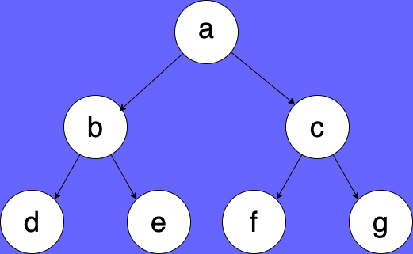

# 题目描述
144 二叉树的前序遍历 https://leetcode.cn/problems/binary-tree-preorder-traversal/

94 二叉树的中序遍历 https://leetcode.cn/problems/binary-tree-inorder-traversal/

145 二叉树的后序遍历 https://leetcode.cn/problems/binary-tree-postorder-traversal/

# 题解
## 前序遍历
压栈顺序：头-右-左
1. 栈顶弹出记cur,弹出打印
2. 有右压入右，有左压入左，先右再左

## 中序遍历
压栈顺序：左边整条边，来到右节点，再压入左边整条边
1. 当前节点cur，cur整条左边界进栈，直到cur为空
2. 栈顶弹出记cur，弹出打印
3. 当前节点来到右节点上

## 后序遍历
两个栈，一个栈弹出到另一个栈
压栈顺序：头-左-右