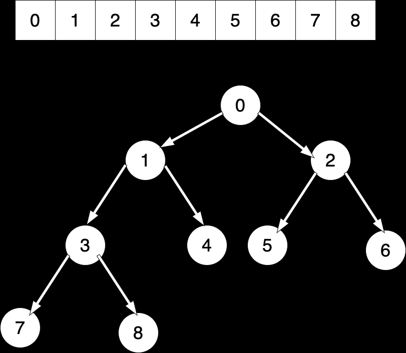

# 数组堆
当前以小根堆为例

## 核心定义
堆的容量为limit，当前堆的大小为heapSize，当前节点为cur
## 核心算法
1. 当前节点：cur
2. 父节点：(cur - 1) / 2
3. 左孩子：2 * cur + 1
4. 右孩子：2 * cur + 2

## 新增节点
1. 新增节点放在数组数组最后一个位置，也就是heapSize的位置，然后heapSize + 1
2. 设置当前节点指向新增节点，指针记为cur
3. cur节点不断和父节点比较，如果当前节点比父节点小，当前节点值和父节点交换位置，cur来到父节点位置，继续和父节点比较

## 删除节点
1. 头节点和堆的最后一个节点进行交换，然后heapSize - 1
2. 设置当前节点指针cur指向头节点head
3. 比较cur节点的左右两个节点，和最小的进行比较
4. 如果当前节点cur比小的子节点更小，则交换这两个节点，cur来到子节点位置,继续和子节点比较
5. 返回删除的头节点