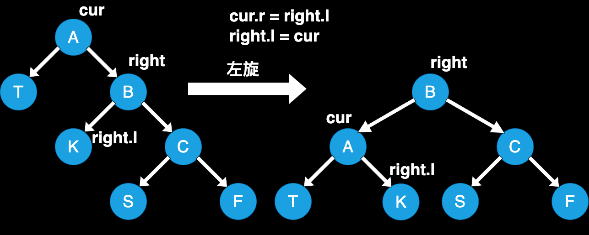
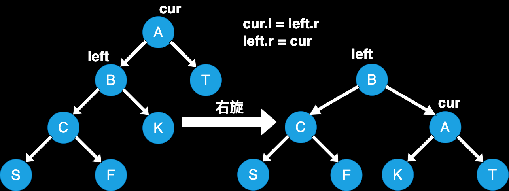
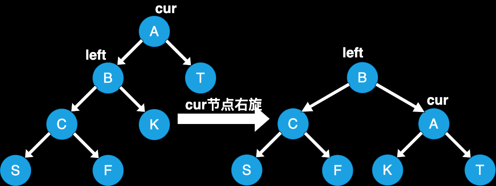
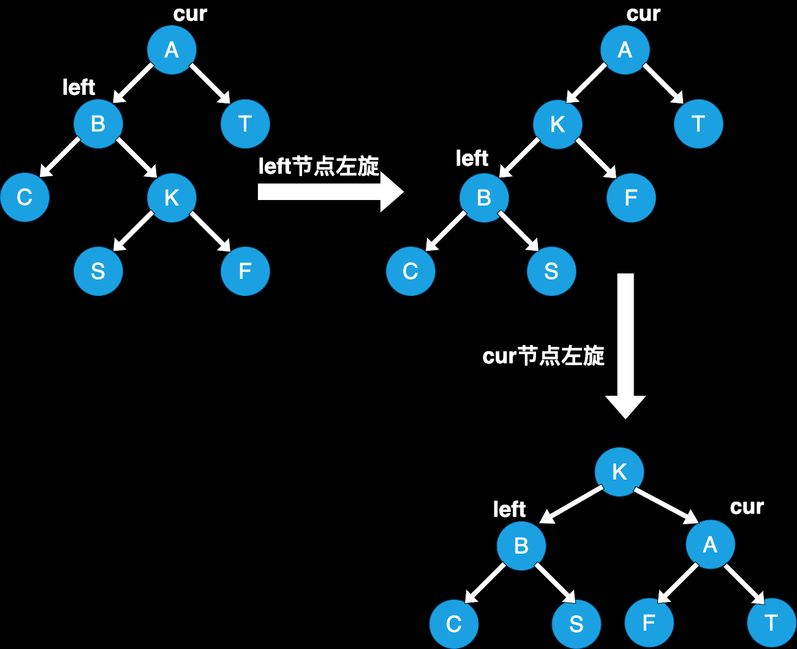
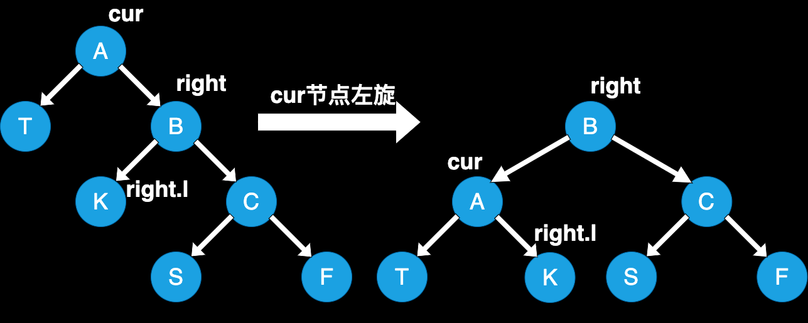
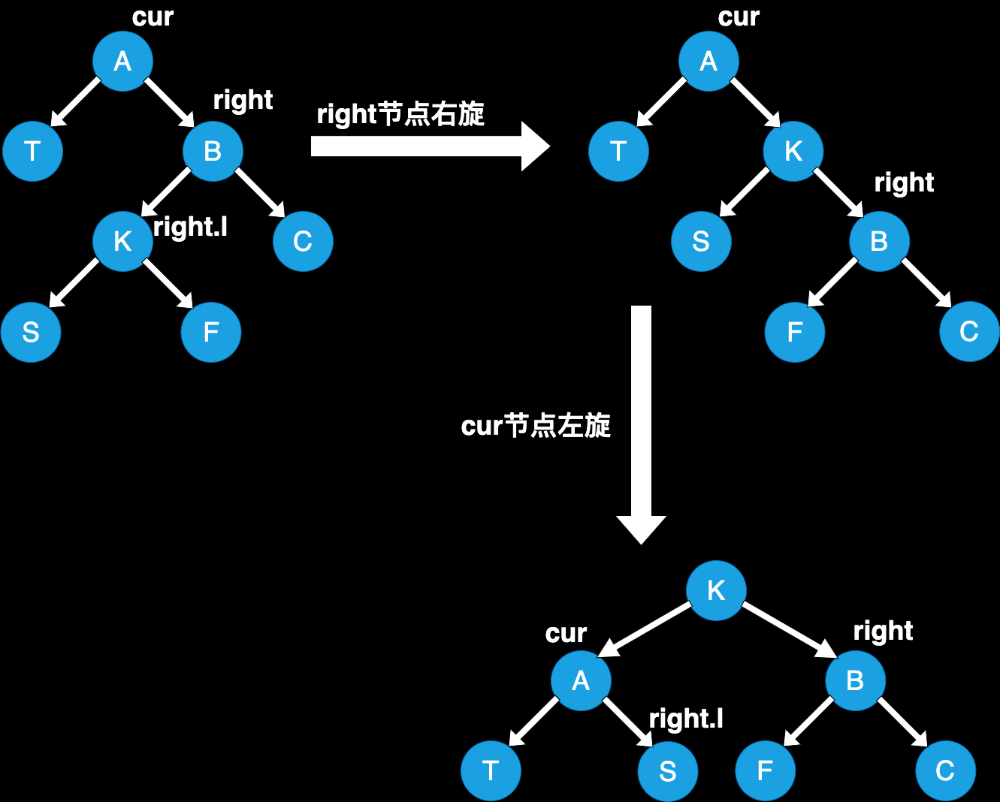

# 核心思想
无论新增节点，还是删除节点，都需要返回新子树的头节点

# 旋转

## 左旋
头节点往左边倒，返回新的头节点

1. 定义 right = cur.r;
2. cur.r = right.l
3. right.l = cur
4. 重新计算 right 的size，为cur的size大小
5. 重新计算 cur 的size，左右子树的size + 1
6. 返回子树根节点right

## 右旋
头节点往右边倒，返回新的头节点

1. 定义 left = cur.l
2. cur.l = left.r;
3. left.r = cur;
4. 重新计算 left 的size，为cur的size大小
5. 重新计算 cur 的高度，左右子树的size + 1
6. 返回子树根节点left

# 四种违规行为
## LL型违规
左树过长，做一个右旋

1. 以cur节点为根节点，进行右旋
2. 返回当前树的根节点left

## LR型违规
左树的右树过长，先左旋再右旋

1. 以left节点为根根节点左旋
2. 以cur节点为根根节点右旋

## RR型违规
右树过长，做一个左旋

1. 以cur节点为根节点，进行右旋
2. 返回当前树的根节点right

## RL型违规
右树的左树过长，先右旋再左旋

# 自平衡
1. 根据左右子树以及子子树的size大小，来判断具体是哪种
2. 子树发生变化后需要调用子树的自平衡

# 删除节点X
1. 无左无右：直接删除
2. 有左无右：用左孩子顶替X节点
3. 有右无左：用右孩子顶替X节点
4. 有左有右：
   1. 拿右节点的最左节点替代X节点，沿途size - 1
   2. 拿左节点的最右节点替代X节点，沿途size - 1