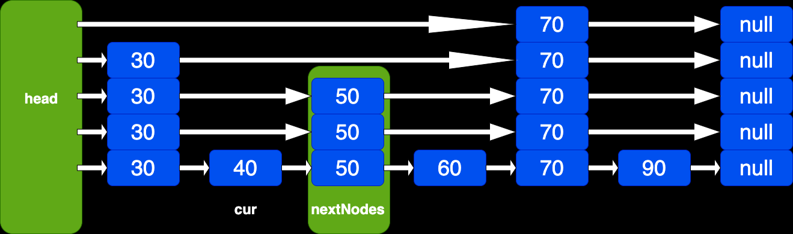

# 核心属性
跳表节点属性： k、v、nextNodes

跳表属性：随机因子P、头节点head、节点数量size、最大层数maxLevel

# 核心基建方法：
1. 在某一层，从cur节点开始，找到level层小于key的最右边节点
2. 在整个跳表上，找到小于key的最右边节点

# 查询节点：
在整个跳表上，找到小于key的最右边节点
判断下一个节点是否是key，如果是则找到了

# 增加节点
1. 根据概率因子P，计算新节点的层高
2. 新节点层高大于跳表最大层高，调整跳表最大层高到新节点高度
   1. 头节点的nextNodes增加null节点
   2. 最大层高++
3. 创建新节点newNode，新节点的nextNodes初始化增加新节点高度个null
4. 将newNode插入到每一层，定义level代表当前遍历的层，从最高层开始遍历
   1. 在level 层中，找到最右的 < key 的节点 pre
   2. 如果level小于等于新节点高度，将新节点加入到pre节点后面
5. level进入下一层,继续插入节点

# 删除节点
1. 定义level为当前层初始化指向maxLevel层，在每一层释放节点
2. 在每一层找到pre节点，根据pre节点找到next节点
3. 如果next节点是要释放的key，则释放这个节点
4. 如果不是最后一层，pre为头节点，头节点下一个节点为null
   1. 头节点nextNodes删除当前level
   2. 最高层maxLevel - 1